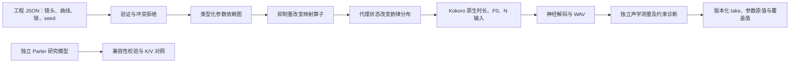

# 架构与已实现边界

完整设计：`docs/DESIGN.md`；原始需求：`docs/DESIGN.md`。

`core/schema.py`：工程、曲线、控制范围与互斥条件。`core/graph.py`：类型/单位/shape
检查、单驱动、拓扑排序、显式延迟反馈。Scalar/vector/tensor/time series/distribution/
operator/constraint/latent/KV 类型均有接口；当前生产链实际使用 scalar/operator/distribution，
其余类型不是已训练的子系统。

`core/coupling.py`：映射函数参数和分布参数的调制、有界代理反演及非破坏性参数对象。
`synthesis/kokoro.py`：冻结模型，原生 token 对齐、F0/N 输入及原始/使用值追踪。
`research/kv.py`：同模型、同位置、同文本、同层/shape/dtype/device 的 cache 检查与 patch。
`research/parler.py`：真实模型 hook 对照；不改变 RoPE/绝对位置，不裁剪 cache 长度。

`pipeline.py`：每次创建新 take，保存工程/WAV/对齐/声学分析/哈希/版本及锁诊断。
现有目录拒绝覆盖。30 秒上限在密集对齐分配前检查。失败保留 `failure.json`。
CLI 是 M1 工作入口，尚无 Qt 时间轴、节点编辑器、局部重合成或 Blender 插件。

音素边界是模型 token 对齐，包含重音/空格/标点/BOS/EOS；不能当作真实音素 forced alignment。
目前未输出未经验证的 viseme 标签。帧率、起始帧和镜头信息已随 take 导出。
